# theme-rip

Bộ lưu **4 theme website** (bản dựng lại / local rebuild) kèm **ảnh chụp toàn bộ trang** ở dạng full-page.
Mỗi theme đóng gói trong một hoặc hai file ZIP: bản `source` (để sửa) và bản `build`/`static` (chạy ngay).

> Đây là bản lưu phục vụ nghiên cứu giao diện và lưu trữ cá nhân. Toàn bộ thiết kế, nội dung, hình ảnh, font và nhãn hiệu thuộc về chủ sở hữu gốc tương ứng.

**4 theme · 35 trang · 7 file ZIP**

**Gallery online: <https://aquaplatinumberlitz.github.io/theme-rip/>**

## Demo

Ảnh full-page của từng trang nằm trong [`docs/screenshots/`](docs/screenshots) (WebP, rộng 1440 px).
Gallery: **<https://aquaplatinumberlitz.github.io/theme-rip/>** (nguồn: [docs/index.html](docs/index.html), GitHub Pages build từ `/docs`).

| Theme | Trang | Xem trước |
|---|---|---|
| **ArtCraft** | 24 | [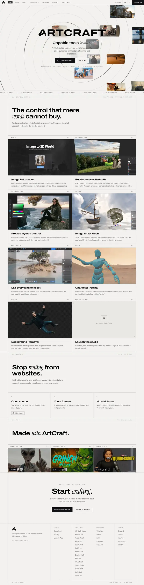](docs/screenshots/artcraft/home.webp) |
| **Doraemon Channel** | 8 | [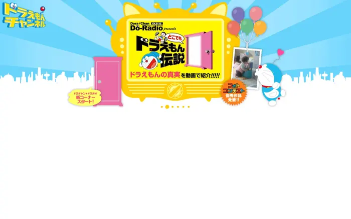](docs/screenshots/doraemon/birthday.webp) |
| **Punktfunk** | 1 | [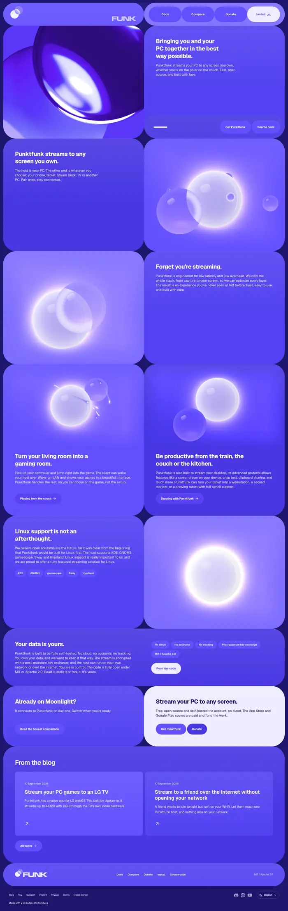](docs/screenshots/punktfunk/home-en.webp) |
| **Sulat Models** | 2 | [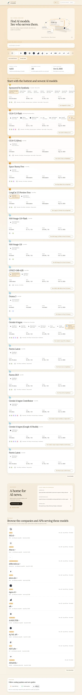](docs/screenshots/sulat-models/home.webp) |

## Nội dung

| Theme | ZIP | Dung lượng | Trang |
|---|---|---|---|
| **ArtCraft** | [`artcraft-local-build.zip`](themes/artcraft-local-build.zip) | 70.7 MB | 24 |
|  | [`artcraft-local-source.zip`](themes/artcraft-local-source.zip) | 101.2 MB |  |
| **Doraemon Channel** | [`doraemon theme_refactored.2026-10-27 opus5.5.zip`](themes/doraemon%20theme_refactored.2026-10-27%20opus5.5.zip) | 5.8 MB | 8 |
| **Punktfunk** | [`punktfunk-rebuild-source.zip`](themes/punktfunk-rebuild-source.zip) | 629 KB | 1 |
|  | [`punktfunk-rebuild-static.zip`](themes/punktfunk-rebuild-static.zip) | 422 KB |  |
| **Sulat Models** | [`sulat-models-local-build.zip`](themes/sulat-models-local-build.zip) | 882 KB | 2 |
|  | [`sulat-models-local-source.zip`](themes/sulat-models-local-source.zip) | 2.5 MB |  |

`artcraft-local-source.zip` (101 MB) vượt giới hạn 100 MB của GitHub nên được lưu bằng **Git LFS**. Cài `git-lfs` trước khi clone:

```sh
git lfs install
git clone https://github.com/aquaplatinumberlitz/theme-rip.git
```

Nếu không muốn dùng LFS, tải file trực tiếp trên GitHub (nút *Download raw file* sẽ trả về file thật).

## ArtCraft

*artcraft.ai — website + studio*

Bản dựng lại website ArtCraft và studio tạo ảnh/video: 24 trang tĩnh, Next.js export, media local (webm, wasm, ảnh).

```sh
cd themes && unzip artcraft-local-build.zip && cd artcraft-local-build && npm start   # http://localhost:4175/
```

<details open>
<summary><b>24 trang</b> — ảnh full-page (bấm để mở bản đầy đủ)</summary>

| Trang | Đường dẫn | Ảnh |
|---|---|---|
| Trang chủ | `/` | [](docs/screenshots/artcraft/home.webp) |
| Craft Apps | `/apps/` | [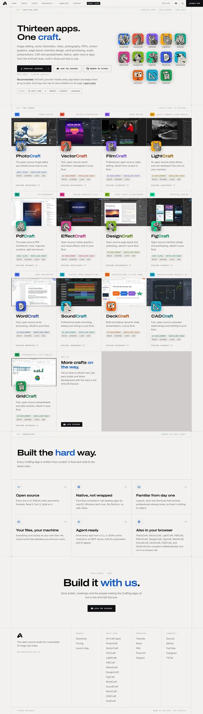](docs/screenshots/artcraft/apps.webp) |
| CadCraft | `/apps/cadcraft/` | [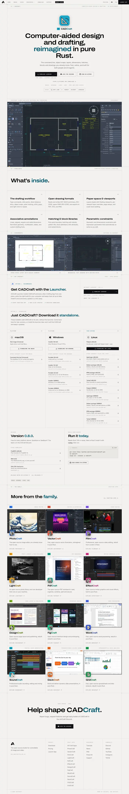](docs/screenshots/artcraft/apps-cadcraft.webp) |
| DeckCraft | `/apps/deckcraft/` | [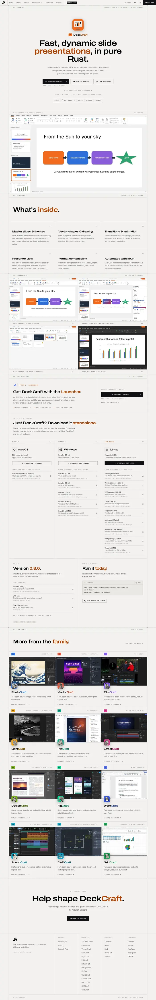](docs/screenshots/artcraft/apps-deckcraft.webp) |
| DesignCraft | `/apps/designcraft/` | [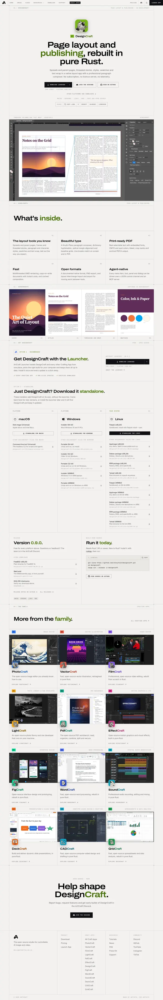](docs/screenshots/artcraft/apps-designcraft.webp) |
| EffectCraft | `/apps/effectcraft/` | [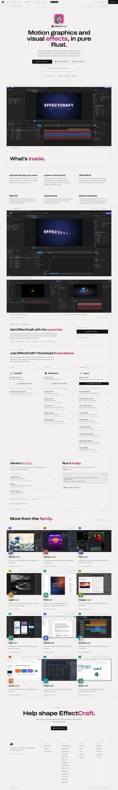](docs/screenshots/artcraft/apps-effectcraft.webp) |
| FigCraft | `/apps/figcraft/` | [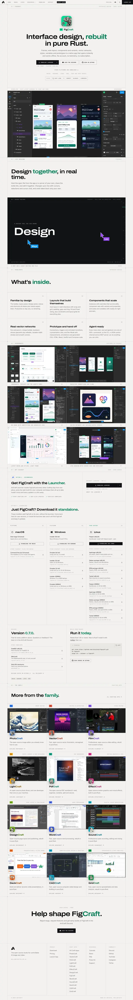](docs/screenshots/artcraft/apps-figcraft.webp) |
| FilmCraft | `/apps/filmcraft/` | [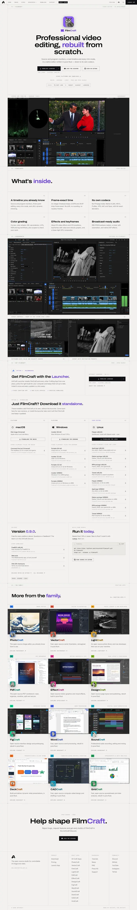](docs/screenshots/artcraft/apps-filmcraft.webp) |
| GridCraft | `/apps/gridcraft/` | [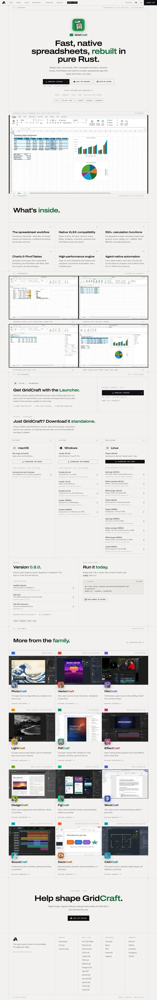](docs/screenshots/artcraft/apps-gridcraft.webp) |
| LightCraft | `/apps/lightcraft/` | [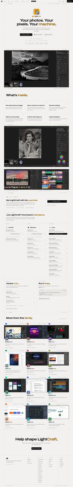](docs/screenshots/artcraft/apps-lightcraft.webp) |
| PdfCraft | `/apps/pdfcraft/` | [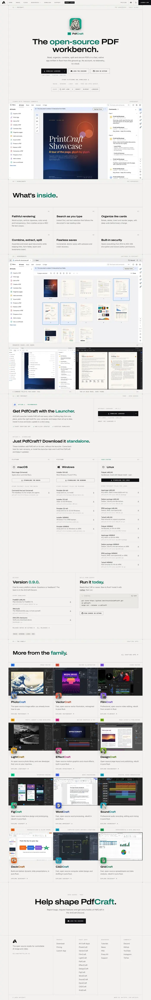](docs/screenshots/artcraft/apps-pdfcraft.webp) |
| PhotoCraft | `/apps/photocraft/` | [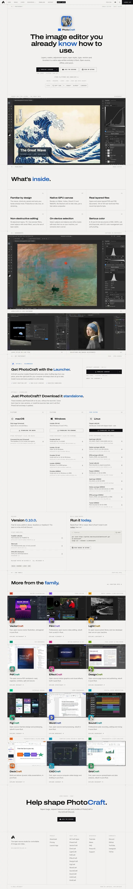](docs/screenshots/artcraft/apps-photocraft.webp) |
| SoundCraft | `/apps/soundcraft/` | [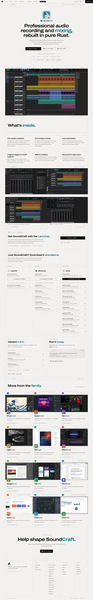](docs/screenshots/artcraft/apps-soundcraft.webp) |
| VectorCraft | `/apps/vectorcraft/` | [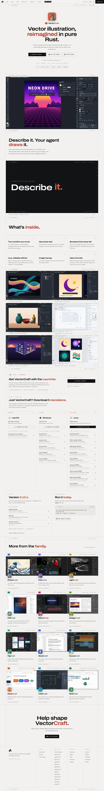](docs/screenshots/artcraft/apps-vectorcraft.webp) |
| WordCraft | `/apps/wordcraft/` | [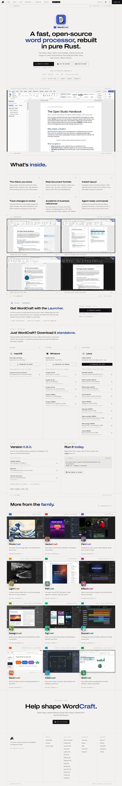](docs/screenshots/artcraft/apps-wordcraft.webp) |
| Studio — Image | `/create-image/` | [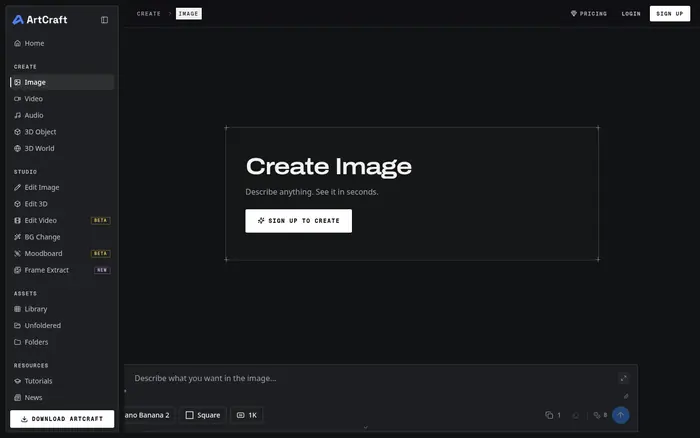](docs/screenshots/artcraft/create-image.webp) |
| Studio — Video | `/create-video/` | [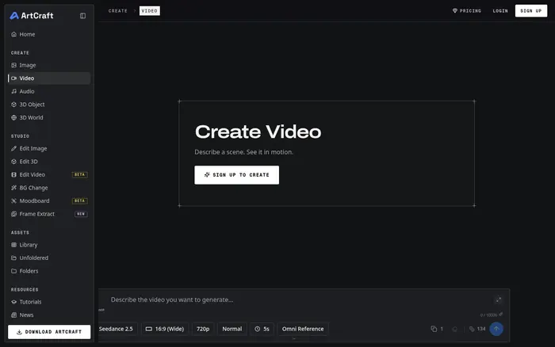](docs/screenshots/artcraft/create-video.webp) |
| Download | `/download/` | [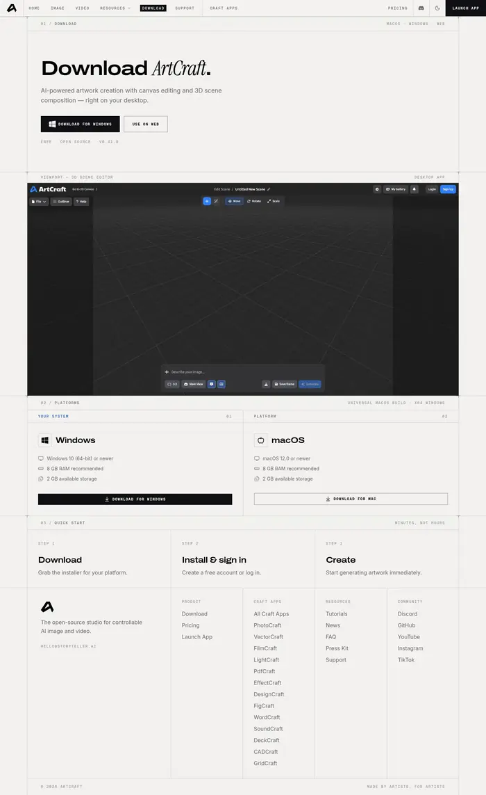](docs/screenshots/artcraft/download.webp) |
| FAQ | `/faq/` | [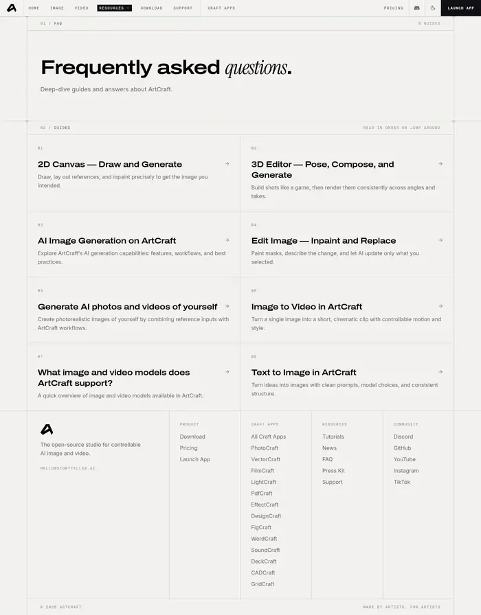](docs/screenshots/artcraft/faq.webp) |
| News | `/news/` | [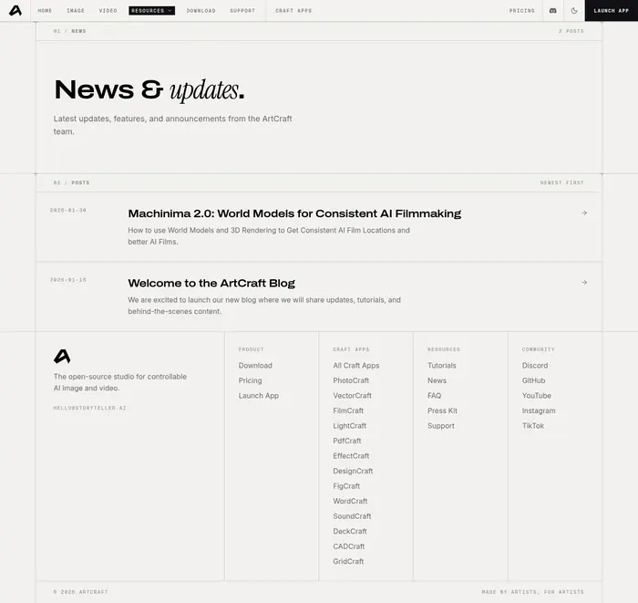](docs/screenshots/artcraft/news.webp) |
| Press kit | `/press-kit/` | [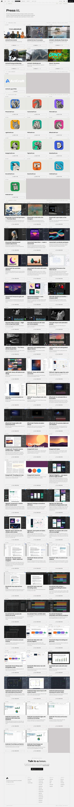](docs/screenshots/artcraft/press-kit.webp) |
| Pricing | `/pricing/` | [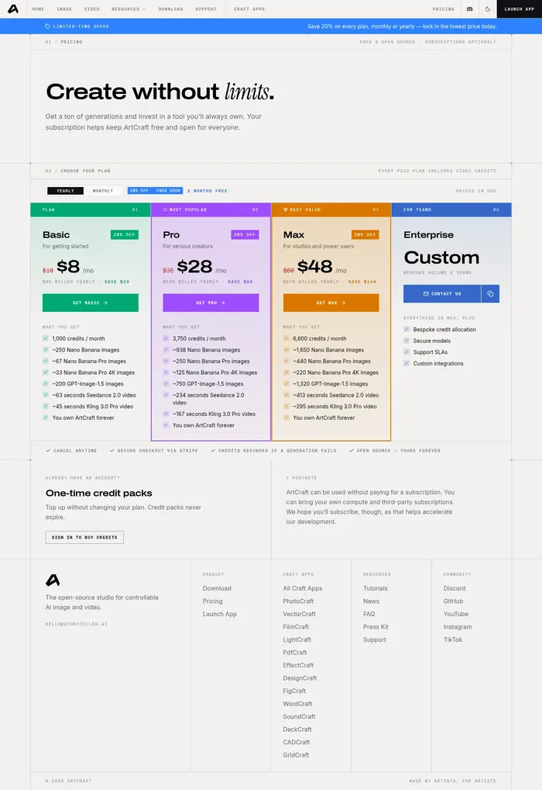](docs/screenshots/artcraft/pricing.webp) |
| Support | `/support/` | [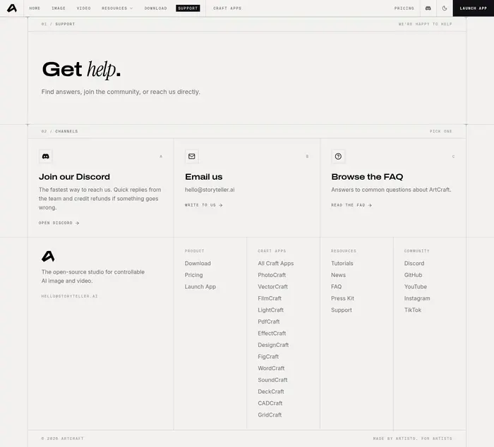](docs/screenshots/artcraft/support.webp) |
| Tutorials | `/tutorials/` | [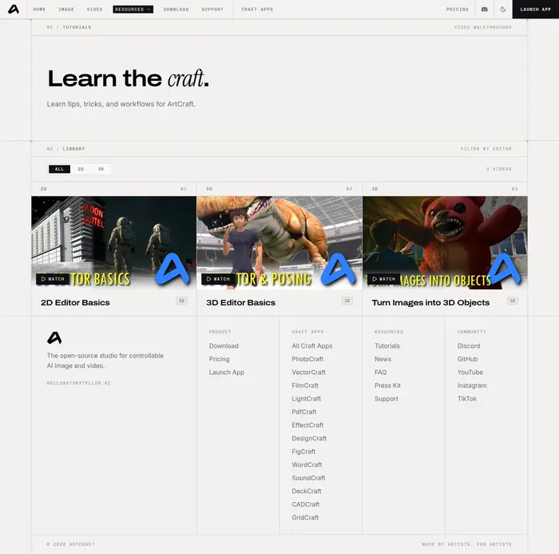](docs/screenshots/artcraft/tutorials.webp) |

</details>

## Doraemon Channel

*doraemon-channel.jp — theme theo mùa*

8 trang theme Doraemon Channel (birthday, eiga, lunar_newyear, newyear, noel, normal_angel, normal_mouse, sample_test).

```sh
cd themes && unzip "doraemon theme_refactored.2026-10-27 opus5.5.zip" && python3 -m http.server 8103 -d "doraemon theme_refactored"   # http://localhost:8103/birthday/
```

<details open>
<summary><b>8 trang</b> — ảnh full-page (bấm để mở bản đầy đủ)</summary>

| Trang | Đường dẫn | Ảnh |
|---|---|---|
| Birthday | `/birthday/` | [](docs/screenshots/doraemon/birthday.webp) |
| Eiga (phim) | `/eiga/` | [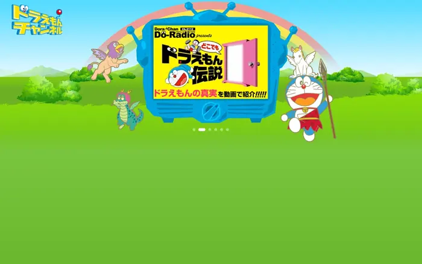](docs/screenshots/doraemon/eiga.webp) |
| Lunar New Year | `/lunar_newyear/` | [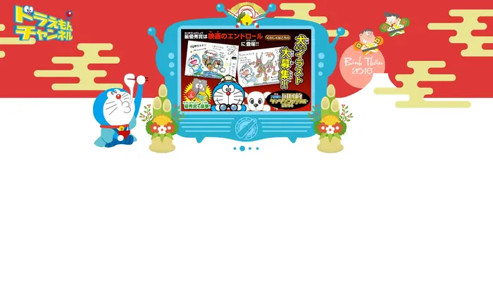](docs/screenshots/doraemon/lunar_newyear.webp) |
| New Year | `/newyear/` | [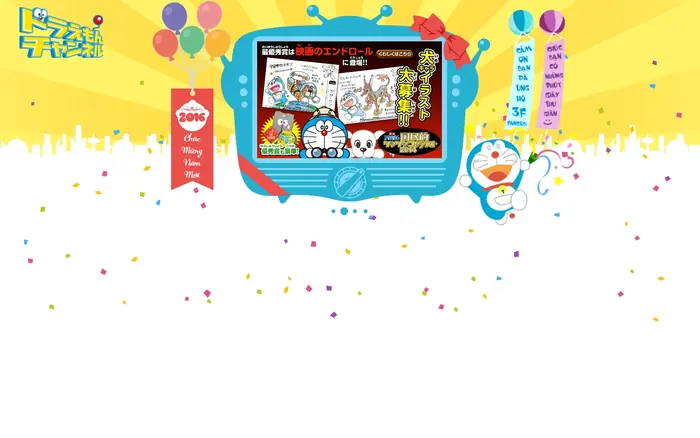](docs/screenshots/doraemon/newyear.webp) |
| Noel | `/noel/` | [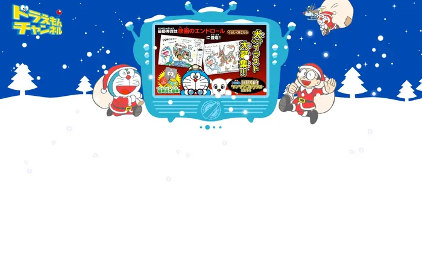](docs/screenshots/doraemon/noel.webp) |
| Normal — Angel | `/normal_angel/` | [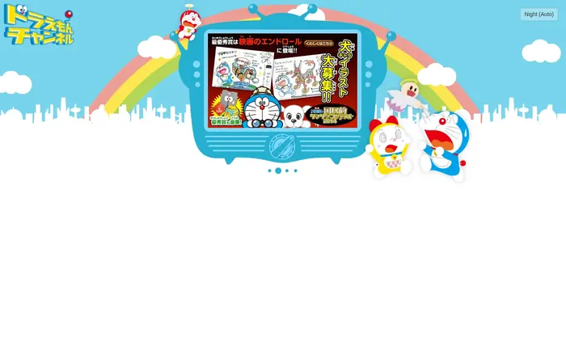](docs/screenshots/doraemon/normal_angel.webp) |
| Normal — Mouse | `/normal_mouse/` | [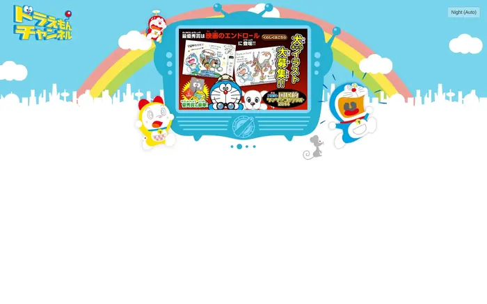](docs/screenshots/doraemon/normal_mouse.webp) |
| Sample test | `/sample_test/` | [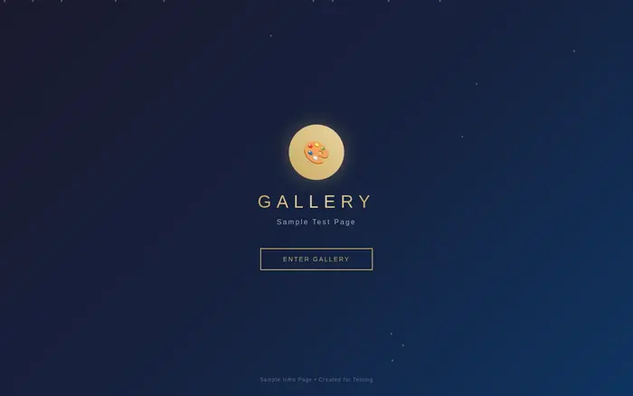](docs/screenshots/doraemon/sample_test.webp) |

</details>

## Punktfunk

*punktfunk.unom.io/en — trang chủ*

Trang chủ Punktfunk dựng lại: ES modules, 5 scene Canvas 2D + WebGL2 procedural, responsive, font local.

```sh
cd themes && unzip punktfunk-rebuild-source.zip && cd punktfunk-rebuild && npm run dev   # http://localhost:4173/en/
```

<details open>
<summary><b>1 trang</b> — ảnh full-page (bấm để mở bản đầy đủ)</summary>

| Trang | Đường dẫn | Ảnh |
|---|---|---|
| Trang chủ (EN) | `/en/` | [](docs/screenshots/punktfunk/home-en.webp) |

</details>

## Sulat Models

*models.sulat.com — home + model detail*

Hai trang Sulat Models (home và /models/xai-grok-45-97244c89) chạy bằng Node server, dữ liệu JSON snapshot, cảnh 3D + CSS effects.

```sh
cd themes && unzip sulat-models-local-build.zip && cd sulat-models-local && npm start   # http://localhost:4174/
```

<details open>
<summary><b>2 trang</b> — ảnh full-page (bấm để mở bản đầy đủ)</summary>

| Trang | Đường dẫn | Ảnh |
|---|---|---|
| Trang chủ | `/` | [](docs/screenshots/sulat-models/home.webp) |
| Model — xai-grok-45-97244c89 | `/models/xai-grok-45-97244c89` | [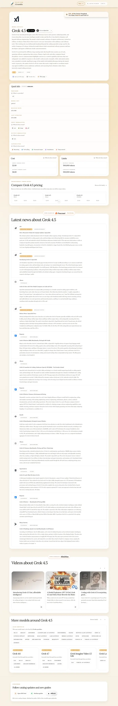](docs/screenshots/sulat-models/model-grok-45.webp) |

</details>

## Cấu trúc repo

```
theme-rip/
├── README.md
├── .gitattributes          # LFS cho zip > 100 MB
├── themes/                 # 7 file ZIP gốc
└── docs/
    ├── index.html          # gallery toàn bộ ảnh
    ├── meta.json           # metadata từng ảnh (theme, trang, URL, kích thước)
    ├── screenshots/        # ảnh full-page 1440 px (WebP)
    └── thumbs/             # bản thu nhỏ 700 px dùng cho README
```

## Ghi chú kỹ thuật

- Ảnh chụp bằng Chromium headless qua CDP, viewport 1440×900, `captureBeyondViewport` để lấy toàn trang.
- Trước khi chụp: cuộn hết trang để kích hoạt lazy-load/IntersectionObserver, rồi ép mọi `<video>` load và seek về một frame để không bị ô xám.
- Trang cao bất thường được giới hạn 16 000 px. Ảnh lưu WebP q86 (README dùng thumb 700 px q76).
- ArtCraft/`press-kit` cao 15 597 px, Sulat home 12 076 px — đây là chiều cao thật của trang.

## Checksum ZIP

| File | SHA-256 (16 ký tự đầu) |
|---|---|
| `artcraft-local-build.zip` | `b9fe8dba64a2241d` |
| `artcraft-local-source.zip` | `761e4b172a25b679` |
| `doraemon theme_refactored.2026-10-27 opus5.5.zip` | `be7e28ebeda38fb2` |
| `punktfunk-rebuild-source.zip` | `de25e04681087fb1` |
| `punktfunk-rebuild-static.zip` | `6da472abc7cd9ae5` |
| `sulat-models-local-build.zip` | `b09680432bb45040` |
| `sulat-models-local-source.zip` | `dadb27c9e148d2b5` |

## License / bản quyền

Repo này **không** cấp phép lại nội dung của bên thứ ba. ArtCraft, Doraemon Channel, Punktfunk và Sulat Models cùng toàn bộ tài sản đi kèm thuộc quyền của chủ sở hữu tương ứng; các file ở đây là bản lưu cục bộ cho mục đích học tập/nghiên cứu giao diện. Nếu là chủ sở hữu và muốn gỡ bỏ, hãy mở issue.
